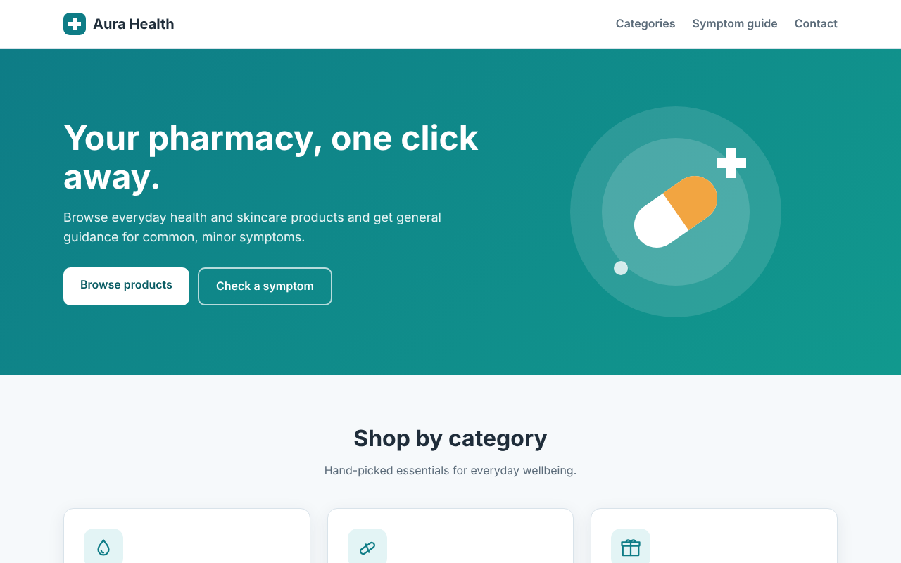
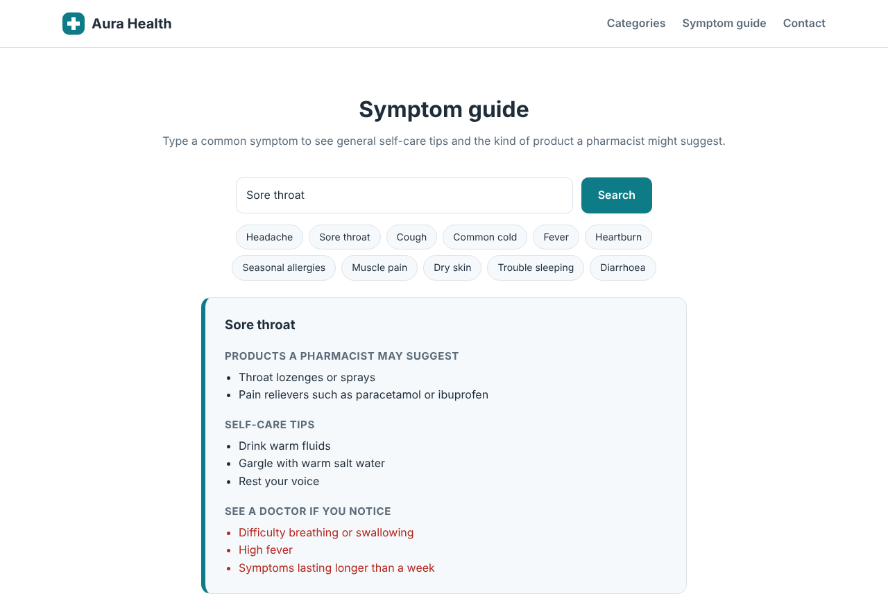

# Aura Health – Online Pharmacy Prototype

A multi-page website for a fictional online pharmacy: a product catalogue, an interactive symptom guide and a contact form backed by PHP and MySQL.



## Features

- **Product catalogue** – three categories (skin care, supplements, value bundles) with product cards and prices
- **Symptom guide** – a client-side JavaScript tool that matches a typed symptom (or a quick-select chip) against a structured dataset of eleven common, minor complaints and shows:
  - the type of over-the-counter product a pharmacist might suggest
  - self-care tips
  - warning signs that mean the user should see a doctor
- **Contact form** – validated on the client and the server, then stored in MySQL
- **Responsive layout** for desktop and mobile, built with plain CSS (Grid and Flexbox), no frameworks



## Security

- The contact form uses **PDO prepared statements**, which protects against SQL injection
- Input length and email format are validated on the server; errors are shown without exposing database details
- Database credentials are kept in `config.php`, which is excluded from version control
- The symptom guide renders results with `textContent`, so user input is never inserted as HTML (prevents XSS)
- A hidden honeypot field filters out simple spam bots

## Tech stack

| Layer | Technology |
|---|---|
| Front end | HTML5, CSS3, vanilla JavaScript |
| Back end | PHP 8 |
| Database | MySQL / MariaDB |

## Project structure

```
AuraHealth
├── index.html            Home page: categories, symptom guide, contact form
├── skin-care.html        Category pages
├── supplements.html
├── bundles.html
├── message-sent.html     Confirmation page after a successful submission
├── contact.php           Validates and stores contact messages
├── config.example.php    Template for database credentials
├── database
│   └── schema.sql        Database and table definition
├── js
│   └── symptom-guide.js  Symptom dataset, matching and rendering
├── images                Screenshots for this README
└── style.css
```

## Running locally

1. Create the database:
   ```bash
   mysql -u root -p < database/schema.sql
   ```
2. Copy `config.example.php` to `config.php` and enter your database user and password.
3. Start a local server from the project folder:
   ```bash
   php -S localhost:8000
   ```
4. Open http://localhost:8000.

The catalogue and the symptom guide also work when `index.html` is opened directly in a browser; only the contact form needs PHP and MySQL.

## Disclaimer

This is a student project. The products are fictional, and the symptom guide offers general information only. It is not medical advice and does not replace a pharmacist or doctor.

## Author

**Amina Mahmutović** – AI & Data Engineering student, International University of Sarajevo
